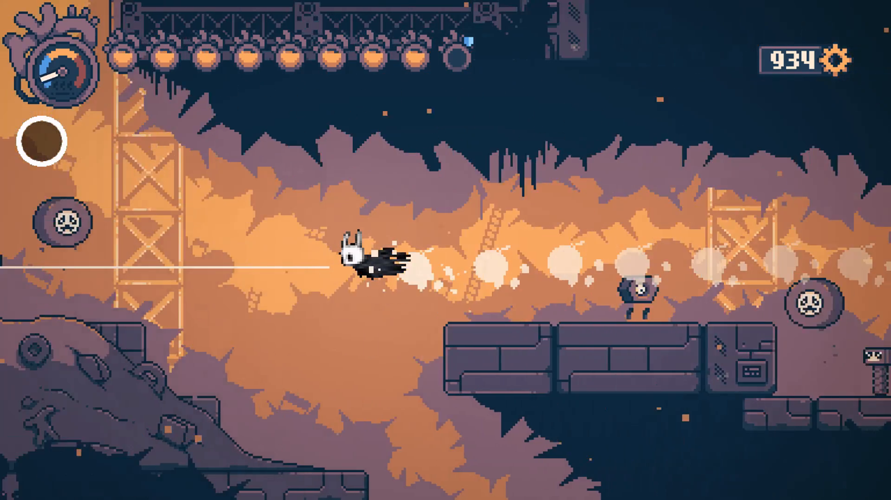
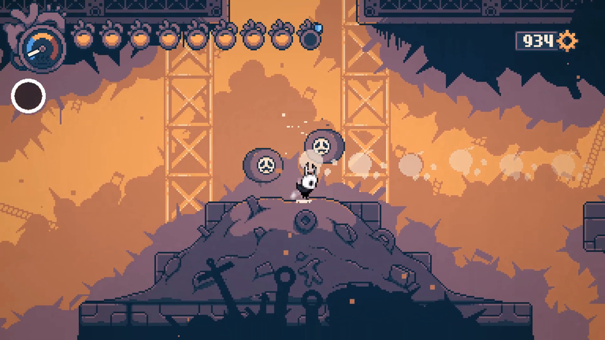
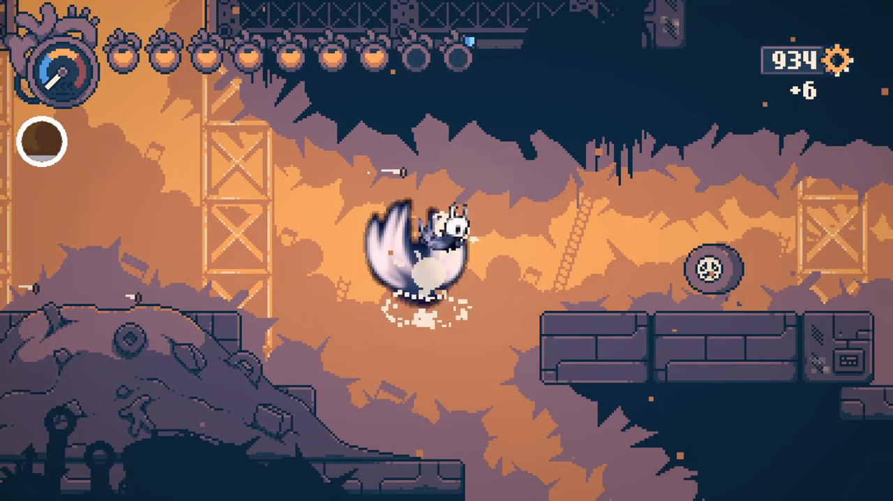
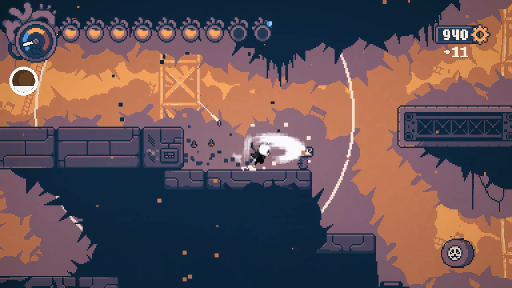

# Hollow the Robot

Play **Haiku, the Robot** as **the Knight** from **Hollow Knight**.

The Knight moves with Haiku's physics: Haiku's run speed, jump arc, coyote time, wall slide and pogo. He brings
his own animations, nail arcs, Soul, spells and Nail Arts with him. It's a BepInEx 5 plugin for Haiku. The
Knight's art is pulled out of **your own Hollow Knight install** when you set the mod up, and none of it is
included in this repo.

| | |
|---|---|
|  |  |
|  |  |

Demo clip (16 s): [docs/video/hollow-the-robot-demo-1.mp4](docs/video/hollow-the-robot-demo-1.mp4)

## Controls (Haiku's buttons, Hollow Knight's moves)

| Hollow Knight | How | Notes |
|---|---|---|
| Nail | Attack (+Up / +Down in the air) | Down-slash pogos like Haiku's. Every hit that connects gives **11 Soul**. |
| Focus | **Hold** Heal | Uses Haiku's repair (spare parts). The Knight plays Focus / Focus Get. |
| Vengeful Spirit | **Tap** Heal | 33 Soul. A projectile that flies until it hits a wall. |
| Howling Wraiths | Up + tap Heal | 33 Soul. Hits three times above you. |
| Desolate Dive | Down + tap Heal | 33 Soul. You're invulnerable on the way down, and the landing hits a wide area. |
| Mothwing Cloak | Dash in mid-air | Once per jump. Needs Haiku's dash. With Haiku's teleport upgrade, Haiku's blink shows as **Shade Cloak**. |
| Monarch Wings | Haiku's double jump | Wings effect. |
| Mantis Claw | Haiku's wall jump | The Knight clings facing away from the wall, as in HK. |
| Great Slash | Hold Attack ~1 s, then release | The Knight glows white when the charge is ready. |
| Dash Slash | Release the charge while dashing | |
| Cyclone Slash | Release the charge while holding Up or Down | You can drift left and right while spinning. |

A Soul vessel sits under Haiku's heat dial. The Knight borrows Haiku's ball shell for Roll.

All of these settings are in `BepInEx/config/dev.hollowtherobot.cfg`: on/off switches, tap time, charge time,
Soul per hit, spell cost and damage multipliers. `Debug Keys = true` adds F5 (fill Soul) and F6 (switch between
the Knight and Haiku).

## Setup (Linux / Proton, the way this was built)

You need:
- Haiku, the Robot and Hollow Knight installed through Steam.
- **BepInEx 5 (win_x64)** in Haiku's folder, with the Steam launch option
  `WINEDLLOVERRIDES="winhttp=n,b" %command%`. On Windows, skip the launch option.
- The **.NET SDK 8+** (to build) and **uv** (for the extractor).

```bash
# 1. Extract the Knight from your Hollow Knight install into Haiku's plugin folder
uv run tools/extract_knight.py            # --hk / --out if your games aren't in the default Steam library

# 2. Build the plugin. The post-build step copies it to BepInEx/plugins/HollowTheRobot/
dotnet build src/HollowTheRobot -c Release   # -p:HaikuDir=... for other install paths
```

Launch Haiku from Steam as usual. To uninstall, delete `BepInEx/plugins/HollowTheRobot`.

## How it works

- **The extractor** (`tools/extract_knight.py`) reads Hollow Knight's `resources.assets` with UnityPy.
  - HK's type trees are stripped, so it rebuilds them from HK's DLLs with TypeTreeGenerator.
  - It then decodes the tk2d `Knight` sprite collection (891 sprites) and the animation libraries for the
    Knight, spells, focus, dust and hits.
  - It un-rotates the packed sprites and downsamples them to Haiku's 16 px/unit pixel art (the Knight ends up
    ~25 px tall).
  - It writes an atlas plus metadata. These are raw RGBA and a text file, because Haiku's Unity build strips
    the PNG and JSON decoders.
- **The plugin** keeps Haiku's `PlayerScript` and Animator running, so physics, sword hits, heals and
  footsteps all stay Haiku's.
  - It hides Haiku's sprite and draws the Knight on a child object, with a small tk2d-style animator.
  - A Harmony transpiler reroutes `PlayerScript.Update`'s Rewired input reads. That's what splits Heal into
    tap = cast / hold = focus, and locks Haiku's controls during spells and Nail Arts.
  - Spells and Nail Arts damage enemies through Haiku's own `IDamageable.TakeDamage`.
  - Effect offsets and scales are copied from the transforms in HK's Knight prefab.
- **The autopilot** (`Autopilot.cs`) is for development only. It runs only if `autotest.txt` is in the plugin
  folder. It loads a save, plays a scripted move list through the input hooks, takes screenshots from inside
  Unity (convert them with `tools/shots_to_png.py`), and quits.

## Not in yet
Crystal Heart, Isma's Tear, the Dream Nail, charms, and Hollow Knight's own sounds (spells use Haiku's sound
events). Spells and Nail Arts are always available instead of being unlocked through Haiku's progression.

## Credits
- Hollow Knight © Team Cherry. Haiku, the Robot © Mister Morris Games. This is an unofficial fan mod: you need
  to own both games, and it ships no game files.
- Built with BepInEx, HarmonyX, UnityPy and TypeTreeGeneratorAPI.
- Written with Claude Code (Anthropic) and the universal-modder plugin.
